<h1 align="center">🎮 Cram Cartridge</h1>

<p align="center">
  <b>Your lecture slides, turned into a retro boss rush.</b><br>
  Upload a PDF, climb a pixel-art mountain, and fight monsters that quote the exact slide you got wrong.
</p>

<p align="center">
  
  
  
  
  
  
</p>

<p align="center">
  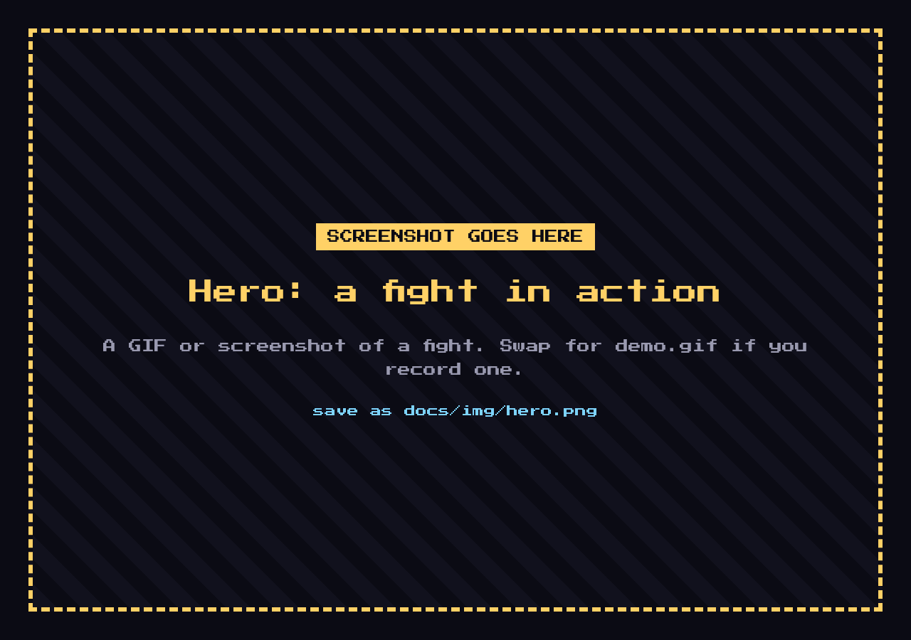
</p>

<p align="center">
  <b>Built with JetBrains Air (Claude Code and Junie agents)</b>
</p>

## 🎬 30-second demo

<p align="center">
  <a href="docs/video/cram-cartridge-demo.mp4">
    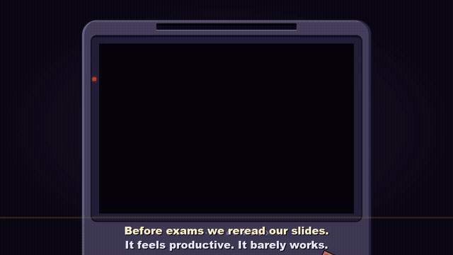
  </a><br>
  <a href="docs/video/cram-cartridge-demo.mp4"><b>▶ Watch with sound (MP4, 30 s)</b></a>
  · recorded straight from the app, music is the game's own chiptune
</p>

| For judges | In one line |
|---|---|
| **Impact** | Every student with lecture slides and an exam: rereading feels productive, testing yourself is what makes it stick. |
| **Tech** | All the AI runs inside Snowflake: `AI_PARSE_DOCUMENT` → `SPLIT_TEXT_RECURSIVE_CHARACTER` → `AI_EMBED` → `AI_COMPLETE`, and the dragon finds your weak spots with `VECTOR_COSINE_SIMILARITY`. |
| **Design** | A handheld you already know how to play: original pixel art and chiptune, all drawn and synthesised in code. |
| **Creativity** | A wrong answer isn't just red: the boss quotes the exact slide you missed, and the final boss remembers your mistakes. |

---

## The idea

Re-reading slides the night before an exam doesn't stick. Cram Cartridge turns each lecture into a
game cartridge. Every topic in the lecture becomes a level, every attack is a question written from
**your own slides**, and every mistake shows you **the exact slide sentence you missed**, page number
included. At the summit, the dragon remembers your latest mistake and pulls in the questions from your
*other* lectures that are closest to it in meaning, so you revise across the course, not one deck at
a time.

All the AI runs inside **Snowflake**: reading the PDF, chunking, embeddings, question writing and
vector search are SQL functions next to the data.

## A run, step by step

### 1. Forge a cartridge

Drop in a lecture PDF. Snowflake reads every page, splits it into chunks, finds the main topic and
3 to 5 subtopics, and writes multiple-choice questions for each one, each tied to the slide it came
from. A 45-page lecture takes about a minute.

<p align="center">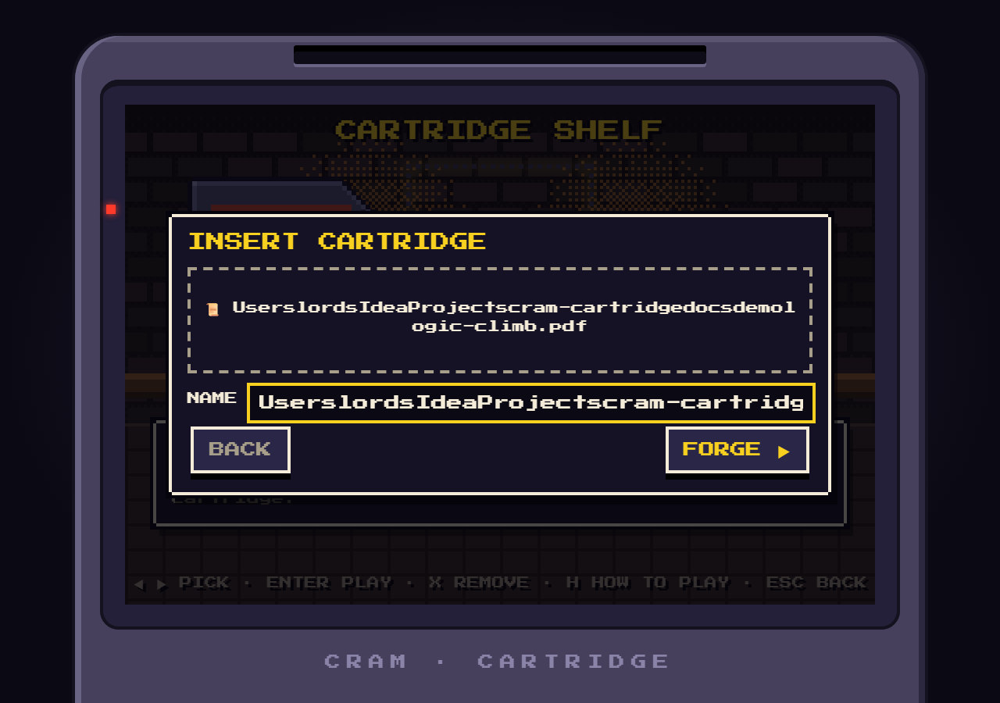</p>

### 2. Pick it from the shelf

Your uploaded lectures sit next to two built-in demo cartridges.

<p align="center">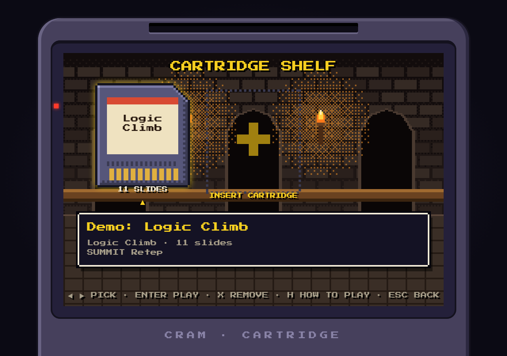</p>

### 3. Climb the mountain

One level per subtopic (up to five), each a biome with a regular enemy and then its boss, and the
dragon at the summit. Level 2 adds a timed Blitz round, and treasure chests wait after levels 1 and 3.

| Level | Biome | Enemy | Boss |
|---|---|---|---|
| 1 | Underground | Torchmite | Minotaur |
| 2 | Stormy cave | Brinecrab | Hydra |
| 3 | Dead forest | Hollow Crow | Thornhart |
| 4 | Snowy mountain | Frost Imp | Yeti |
| 5 | Volcano | Cinder Slug | Phoenix |
| Summit | Cloudy summit | | Retep, the dragon |

<p align="center">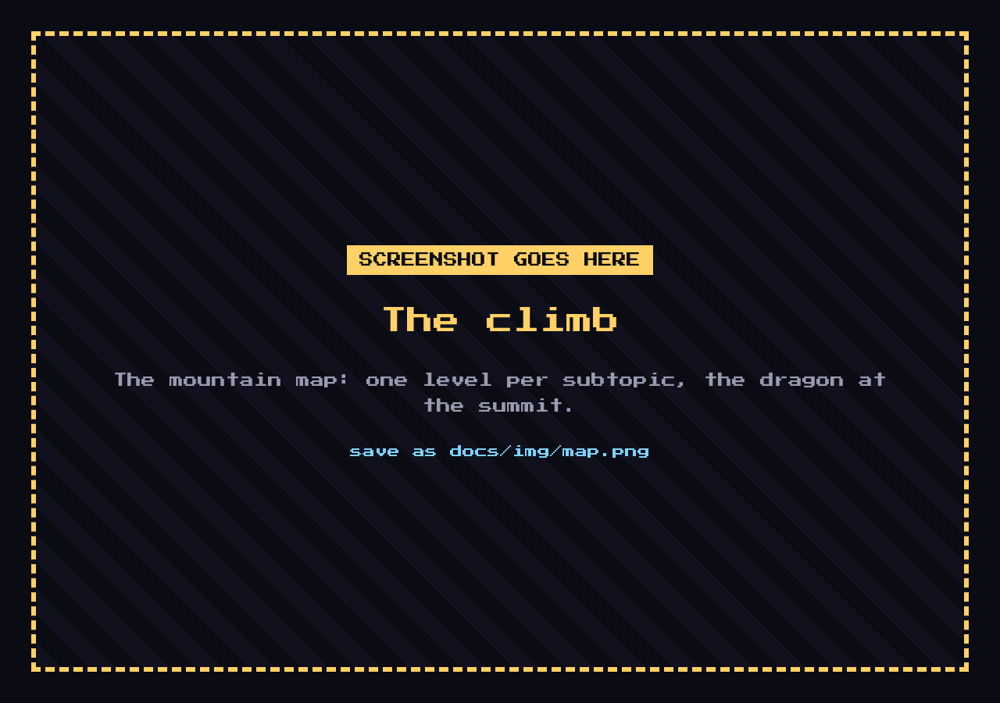</p>

| | |
|---|---|
| 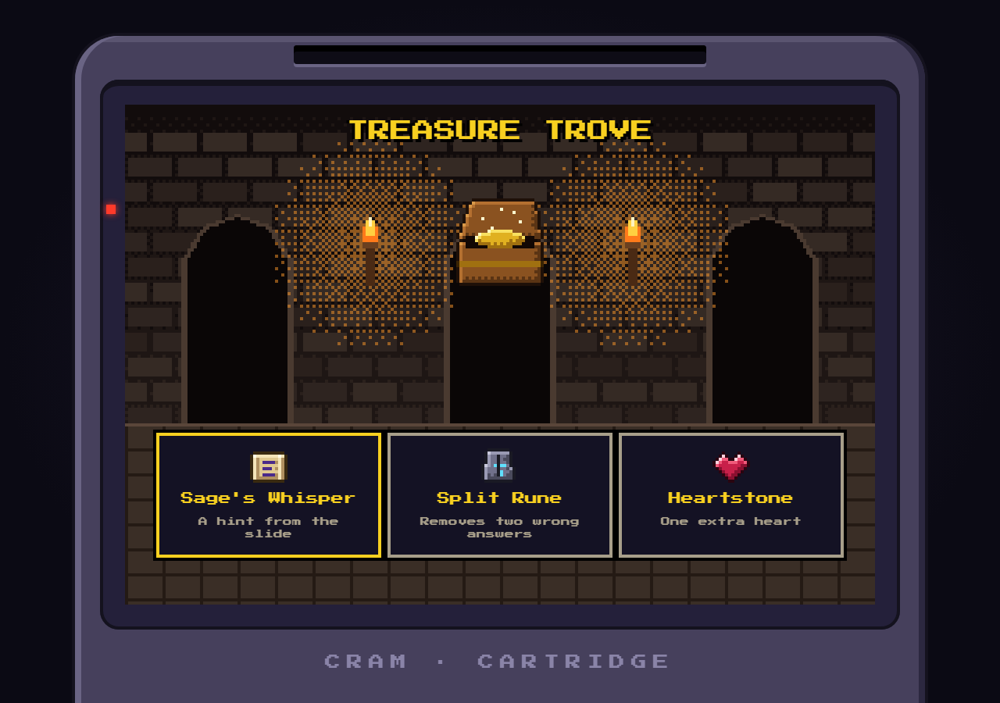 | 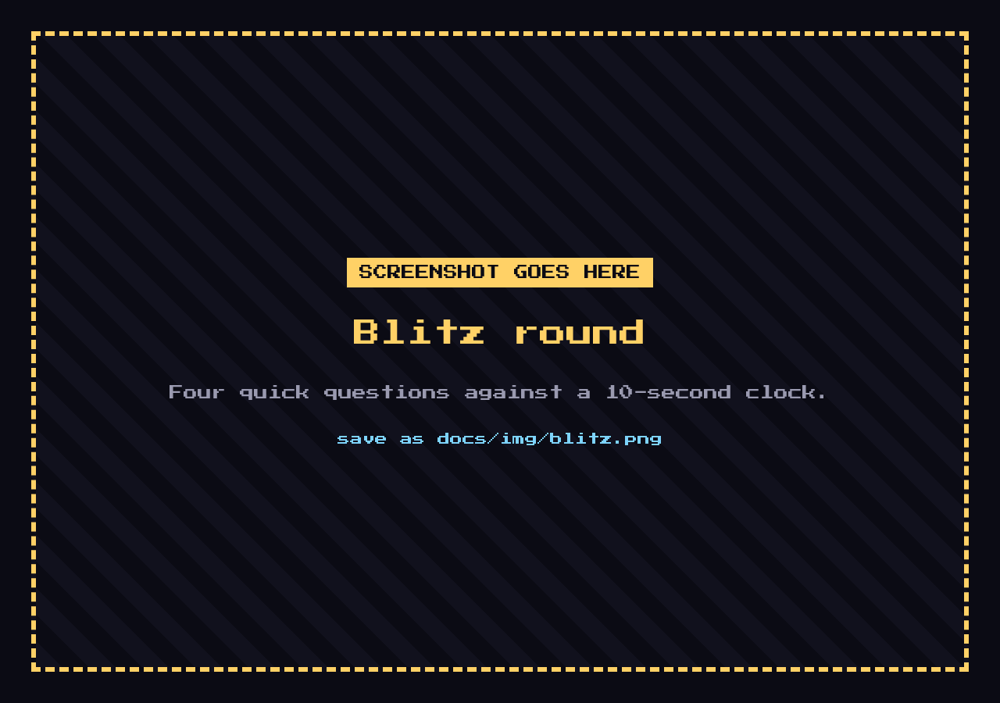 |
| Treasure: Split Rune hides two wrong answers, Sage's Whisper gives a hint from the slide, Heartstone adds a heart, Aegis Ward blocks a hit | Blitz: four quick questions, ten seconds each, timed by the server |

### 4. Every attack is a question from your slides

| | |
|---|---|
| 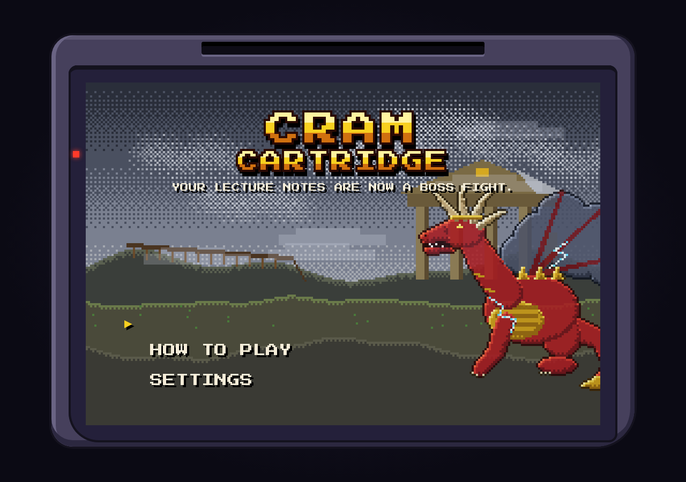 | 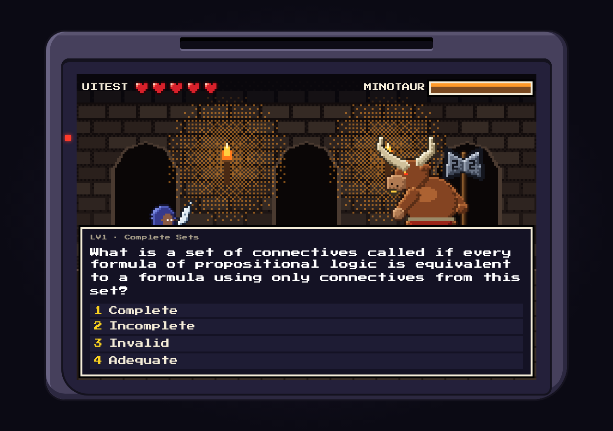 |
| Start screen | Answer to strike; miss and the boss hits back |

### 5. Miss, and the boss quotes the slide you missed

The quote card shows the slide sentence the question came from, its page, the right answer and a
one-line explanation. A missed question comes back before the fight ends.

<p align="center">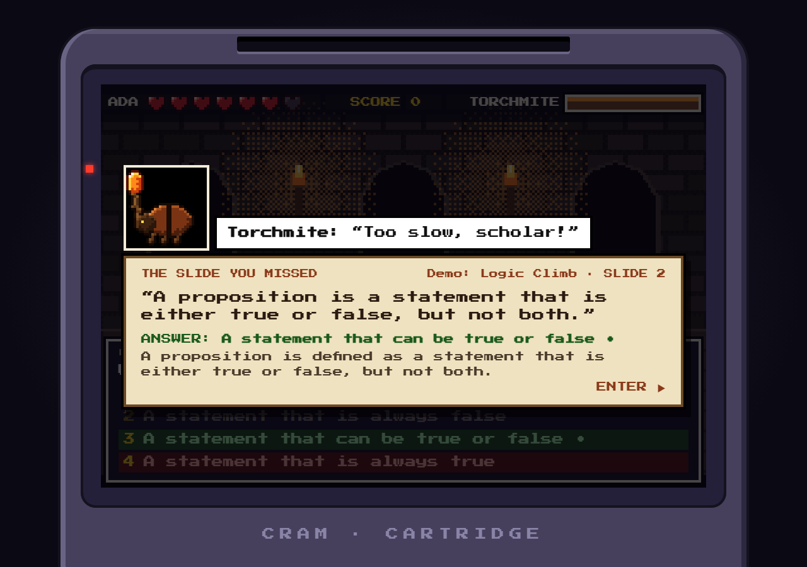</p>

### 6. Retep, the dragon, remembers

The summit fight opens with a **reworded version of your latest mistake**. Its next two questions
come from **your other lectures**: Snowflake ranks every question on every cartridge by cosine
similarity to that mistake and brings in the closest ones, score shown.

| | |
|---|---|
|  | 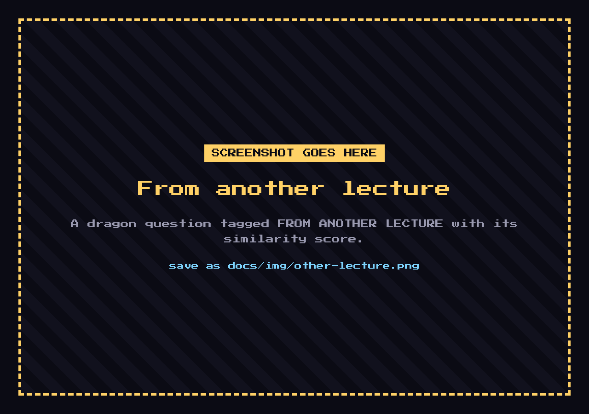 |
| "You missed this": your mistake, reworded | Closest question from another lecture |

### 7. Results, weak spots and high scores

Score, accuracy, time and bosses beaten, then your weakest subtopics with the slides you miss most.
Climb again and those weak spots come first.

| | | |
|---|---|---|
| 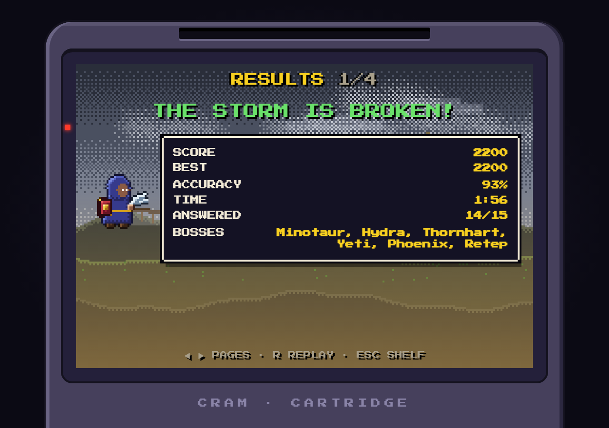 | 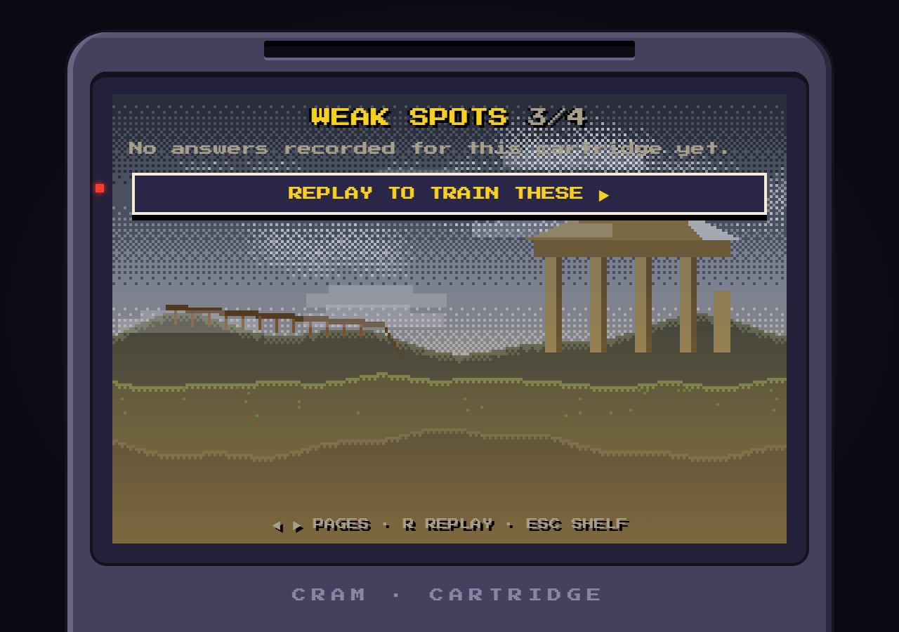 | 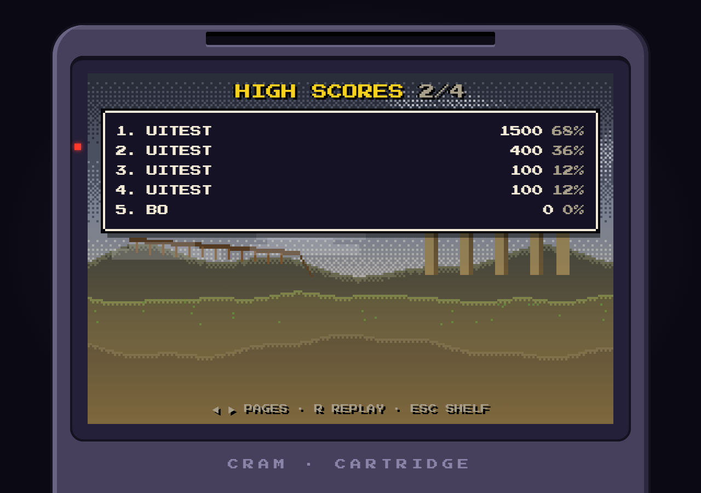 |
| Results | Weak spots | High scores |

## Art and audio

All game art (sprites, backgrounds, icons, the console frame) is original and drawn in code in
[`frontend/src/art/`](frontend/src/art); nothing is copied from existing games. A designer can
replace any sprite by dropping `frontend/src/assets/sprites/<id>.png` (see the `#/gallery` page in
the running game). The music is original too: seven chiptune themes (title, five biomes, the summit)
plus the dragon, victory and defeat, written in [`frontend/src/game/songs.ts`](frontend/src/game/songs.ts)
and synthesised live in the browser with Web Audio (pulse lead, triangle bass, noise drums). No audio
files, nothing licensed.

## Powered by Snowflake

Every AI step is a Snowflake SQL function. The backend only moves rows and checks the model's output.

| Step | Snowflake |
|---|---|
| Store the PDF | `PUT` to a server-side encrypted stage |
| Read every page, tables and maths included | `AI_PARSE_DOCUMENT` (layout mode, one row per page) |
| Chunk the text | `SPLIT_TEXT_RECURSIVE_CHARACTER` |
| Embed chunks, subtopics and questions | `AI_EMBED` with `snowflake-arctic-embed-l-v2.0` (1024 dimensions) |
| Find the topics, write the questions, reword your mistake | `AI_COMPLETE` with `llama3.1-70b` |
| Sort chunks into levels; pick the dragon's questions | `VECTOR_COSINE_SIMILARITY` |
| Remember answers, scores and runs | plain tables, so weak spots and high scores survive a restart |

```mermaid
flowchart LR
  UI[React game] -->|/api| API[FastAPI backend]
  API -->|bound-parameter SQL| SF[(Snowflake)]
  SF --- STAGE[@slides stage]
  SF --- TABLES[decks · slides · chunks · subtopics · questions · attempts · scores · runs]
  SF --- AI[AI_PARSE_DOCUMENT · SPLIT_TEXT · AI_EMBED · AI_COMPLETE · VECTOR_COSINE_SIMILARITY]
```

Every response that touches Snowflake carries a `trace`: each function called, how long it took and,
for the dragon, the cosine scores. The game shows it in the Snowflake panel.

<p align="center">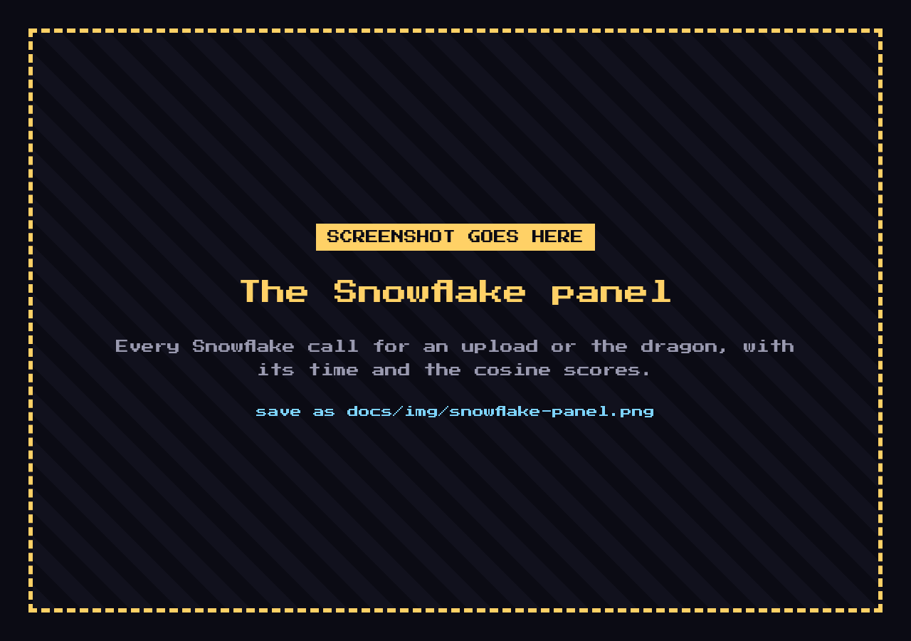</p>

The full pipeline, with real timings: **[SNOWFLAKE_FLOW.md](SNOWFLAKE_FLOW.md)**.

## Built with JetBrains Air

Two people, two laptops, two JetBrains Air agent sessions, one repo. The agents share one set of
rules in [`CLAUDE.md`](CLAUDE.md), [`AGENTS.md`](AGENTS.md) and [`.junie/guidelines.md`](.junie/guidelines.md)
(same content): who owns which folder, the API contract between frontend and backend, and the rules
every agent follows, such as bound SQL parameters only and never sending the answer to the browser
early. Every commit made through Air starts with `Air:`.

## Run it locally

**Snowflake (once).** In a Snowsight worksheet, run the first two statements of
[`sql/00_smoke_test.sql`](sql/00_smoke_test.sql) to create the `CRAM_WH` warehouse and `CRAM`
database. The backend creates its tables on first start.

**Backend** (Python 3.11+, from the repo root):

```bash
python3 -m venv backend/.venv
source backend/.venv/bin/activate      # Windows: backend\.venv\Scripts\activate
pip install -r backend/requirements.txt
cp .env.example .env                    # fill in your Snowflake account, user, password, role
uvicorn backend.main:app --reload --port 8000
```

**Frontend:**

```bash
cd frontend
npm install
npm run dev
```

Open http://localhost:5173. The two built-in demo cartridges work without Snowflake; uploading your
own lectures needs it. [`docs/demo/logic-climb.pdf`](docs/demo/logic-climb.pdf) is our own 5-part
logic crash course: upload it to get a cartridge with all five levels, every boss, the Blitz round and
both treasure chests.

## Repository layout

```
frontend/   React + TypeScript + Vite game, plain CSS, original pixel art
backend/    FastAPI: upload pipeline, game state, Snowflake access
sql/        every Snowflake statement: schema (01_ingest.sql) and queries (02_queries.sql)
docs/img/   screenshots for this README
```

## What's next

- Typed answers for the bosses (the screen exists; the backend comes next)
- Branching paths picked by how well you are doing

## Team

- Backend and Snowflake: *add name*
- Frontend and pixel art: *add name*

## Licence

[MIT](LICENSE)
