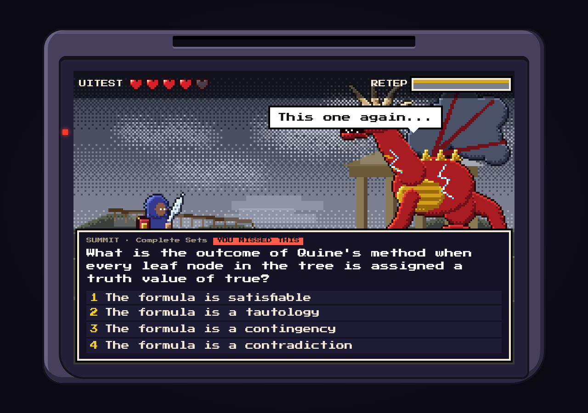

# Cram Cartridge

Built with JetBrains Air (Claude Code and Junie agents)

Upload your lecture slides and they become a game cartridge: a pixel-art climb up a mountain with
one level per topic of the lecture. Every attack is a question written from your own slides. Get one
wrong and the monster quotes the exact slide you missed, with its page number. The dragon at the
summit opens with a reworded version of your latest mistake, then hits you with the questions from
your *other* lectures that are closest in meaning to it.

| | |
|---|---|
|  |  |
|  |  |

Demo video: *coming soon*

## How it uses Snowflake

The whole AI pipeline runs inside Snowflake as SQL: `AI_PARSE_DOCUMENT` reads the PDF,
`SPLIT_TEXT_RECURSIVE_CHARACTER` chunks it, `AI_EMBED` embeds it, `AI_COMPLETE` (llama3.1-70b)
finds the topics and writes the questions, and `VECTOR_COSINE_SIMILARITY` sorts chunks into levels
and lets the dragon pick questions from other lectures by meaning. Answers, high scores and runs are
saved in Snowflake too, so your weak spots follow you between lectures and survive a restart.

Full walkthrough with timings: [SNOWFLAKE_FLOW.md](SNOWFLAKE_FLOW.md).

## Built with JetBrains Air

Two people, two laptops, two JetBrains Air agent sessions, one repo. The shared agent rules live in
[`CLAUDE.md`](CLAUDE.md), [`AGENTS.md`](AGENTS.md) and [`.junie/guidelines.md`](.junie/guidelines.md)
(same content): ownership of each folder, the API contract between frontend and backend, and the
rules every agent follows. Every commit made through Air starts with `Air:`.

## Stack

- `frontend/`: React + TypeScript + Vite, plain CSS, original pixel art
- `backend/`: Python, FastAPI, snowflake-connector-python
- `sql/`: all Snowflake SQL (schema and every query the backend runs)

## Running locally

Snowflake (once, in a Snowsight worksheet): run the first two statements of
[`sql/00_smoke_test.sql`](sql/00_smoke_test.sql) to create the `CRAM_WH` warehouse and the `CRAM`
database. The backend creates its tables itself on first start.

Backend (Python 3.11+, run from the repo root):

```
python3 -m venv backend/.venv
source backend/.venv/bin/activate      # Windows: backend\.venv\Scripts\activate
pip install -r backend/requirements.txt
cp .env.example .env                    # then fill in the Snowflake values
uvicorn backend.main:app --reload --port 8000
```

Frontend:

```
cd frontend
npm install
npm run dev
```

Open the URL Vite prints (usually http://localhost:5173). Requests to `/api` are proxied to the
backend on port 8000. Two demo cartridges are built in, so the game is playable before Snowflake is
set up; uploading your own PDF needs Snowflake.
